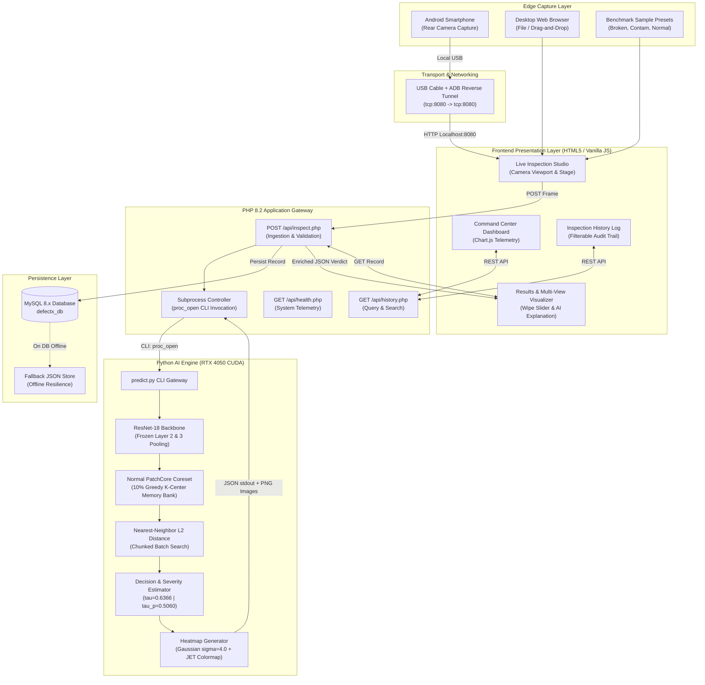

# DEFECTX AI — Industrial Anomaly Detection & Quality Inspection Platform

[](https://pytorch.org)
[](https://php.net)
[](https://mysql.com)
[](https://nvidia.com)
[](LICENSE)

---

## Table of Contents

1. [Project Overview](#1-project-overview)
2. [Key Features](#2-key-features)
3. [System Architecture](#3-system-architecture)
4. [Technology Stack](#4-technology-stack)
5. [Complete Repository Structure](#5-complete-repository-structure)
6. [AI Engine Documentation](#6-ai-engine-documentation)
   - [Methodology & Pipeline](#61-methodology--pipeline)
   - [Feature Extraction & Coreset Selection](#62-feature-extraction--coreset-selection)
   - [Zero-Leakage Decision Thresholding](#63-zero-leakage-decision-thresholding)
   - [Heuristic Severity & Uncalibrated Metric Explanation](#64-heuristic-severity--uncalibrated-metric-explanation)
   - [AI Engine CLI Execution & Commands](#65-ai-engine-cli-execution--commands)
7. [Frontend Documentation](#7-frontend-documentation)
   - [Page Directory & User Interface](#71-page-directory--user-interface)
   - [Multi-View Visualizer Studio](#72-multi-view-visualizer-studio)
   - [AI Decision Explanation Engine UI](#73-ai-decision-explanation-engine-ui)
8. [Backend Documentation](#8-backend-documentation)
   - [PHP 8.2 Service Architecture](#81-php-82-service-architecture)
   - [Subprocess Execution via `proc_open`](#82-subprocess-execution-via-proc_open)
   - [JSON Validation & Error Protocol](#83-json-validation--error-protocol)
9. [Database Documentation](#9-database-documentation)
   - [Schema & Table Architecture](#91-schema--table-architecture)
   - [Dual Persistence & JSON Fallback Store](#92-dual-persistence--json-fallback-store)
10. [REST API Documentation](#10-rest-api-documentation)
    - [`POST /api/inspect.php`](#101-post-apiinspectphp)
    - [`GET /api/inspect.php?id={id}`](#102-get-apiinspectphpidid)
    - [`GET /api/health.php`](#103-get-apihealthphp)
    - [`GET /api/history.php`](#104-get-apihistoryphp)
11. [Installation & Setup (Windows)](#11-installation--setup-windows)
12. [Running the System](#12-running-the-system)
13. [Mobile Camera & USB Live Inspection Workflow](#13-mobile-camera--usb-live-inspection-workflow)
14. [Testing & Empirical Validation](#14-testing--empirical-validation)
15. [Model Evaluation & Benchmark Telemetry](#15-model-evaluation--benchmark-telemetry)
16. [Known Limitations & Quality Safeguards](#16-known-limitations--quality-safeguards)
17. [Security & Industrial Compliance](#17-security--industrial-compliance)
18. [Future Roadmap](#18-future-roadmap)
19. [Project Implementation Status](#19-project-implementation-status)
20. [Team & Contribution Guidelines](#20-team--contribution-guidelines)

---

## 1. Project Overview

**DEFECTX AI** is an enterprise-grade industrial visual anomaly inspection platform developed for the **CLOCKIT 2026 Hackathon**.

### The Industrial Problem
In modern high-throughput manufacturing lines (bottling, container packaging, electronic assembly, precision machining), defects such as fractures, contamination, scratches, micro-chips, and structural misalignments occur rarely but cause catastrophic operational downtime, brand liability, and regulatory penalties. Traditional supervised computer vision models fail in industrial inspection because:
- **Severe Class Imbalance:** Normal defect-free items constitute >99.9% of production lines; defective samples are rare.
- **Open-Set Anomaly Variability:** Real-world defects cannot be anticipated or collected in a predefined training dataset. A bottle may crack in infinite permutations, collect novel chemical contaminants, or deform irregularly.
- **Manual QA Latency:** Human visual inspection is prone to fatigue, subjective bias, and creates severe production bottlenecks.

### The DEFECTX AI Solution
DEFECTX AI solves this challenge using an **unsupervised, open-set visual anomaly detection architecture** inspired by **PatchCore**:
1. **Normal-Only Training:** The model is trained exclusively on normal, defect-free specimen frames (`train/good`). It learns the nominal visual manifold of the component without ever requiring defect examples.
2. **Deterministic Distance Scoring:** During production, specimen image patch tokens are extracted via a pretrained ResNet-18 backbone and evaluated against an optimized memory coreset. Any patch that deviates significantly in Euclidean embedding space triggers an anomaly alert.
3. **Pixel-Level Localization Heatmaps:** Bilinear upsampling and Gaussian smoothing generate calibrated JET anomaly heatmaps and blended overlays, localizing structural damage with zero manual bounding-box annotation.
4. **Edge & Mobile Camera Integration:** The system connects seamlessly to mobile devices via USB ADB reverse tunneling, turning any smartphone into an optical inspection station that streams captures directly to a local RTX 4050 GPU inference engine.
5. **AI Decision Explanation:** Every verdict is accompanied by verifiable mathematical comparisons ($s \ge \tau$ or $s < \tau$), exact margin deltas ($\Delta$), anomalous area surface percentages, and operational disclaimers.

---

## 2. Key Features

| Capability | Module | Implementation Status | Technical Description |
| :--- | :--- | :---: | :--- |
| **PatchCore Anomaly Engine** | `ai-engine/` | **Implemented** | PyTorch ResNet-18 mid-level features (L2+L3, 384-dim) with 10% greedy minimax coreset memory bank. |
| **Zero-Leakage Thresholding** | `ai-engine/` | **Implemented** | Image ($\tau = 0.6366$) and pixel ($\tau_p = 0.5060$) thresholds fitted strictly on held-out normal validation splits. |
| **Pixel Defect Localization** | `ai-engine/` | **Implemented** | Upsampled spatial distance maps with Gaussian smoothing ($\sigma=4.0$) and OpenCV JET colormap blending. |
| **AI Decision Explanation Engine** | `frontend/` & `backend/` | **Implemented** | Generates deterministic numerical rationale: exact score vs threshold comparisons, $\Delta$ margins, and area ratios. |
| **Mobile USB Inspection Station** | `scripts/` & `frontend/` | **Implemented** | Secure Context reverse tunnel (`tcp:8080`) enabling smartphone rear-camera capture with zero SSL friction. |
| **Multi-View Visualizer Studio** | `frontend/` | **Implemented** | Interactive wipe-slider, side-by-side comparison, blended overlay, raw heatmap, and optical stage modes. |
| **Telemetry & Command Center** | `frontend/` | **Implemented** | Real-time industrial dashboard featuring throughput counters, Chart.js severity distribution, and defect tracking. |
| **Inspection Log & History Drawer** | `frontend/` & `backend/` | **Implemented** | Searchable audit trail with severity filters, quick JSON download, and slide-over telemetry drawer. |
| **Hardware & CUDA Health Monitoring** | Full Stack | **Implemented** | Real-time monitoring of NVIDIA RTX 4050 VRAM allocation, CUDA readiness, and CPU fallback states. |
| **Dual Persistence & Fallback Store** | `backend/` | **Implemented** | MySQL PDO primary database storage with automatic graceful fallback to persistent JSON storage. |
| **Confidence Calibration** | `ai-engine/` | *Partially Implemented* | Core engine returns `null`; UI displays *Uncalibrated (Euclidean Metric)* to prevent fabricated probabilities. |
| **Distribution Shift Detector** | `ai-engine/` | *Partially Implemented* | Reserved telemetry interface in `predict.py` for lighting/conveyor speed drift detection. |
| **Batch Specimen Ingestion** | Full Stack | *Planned (Roadmap)* | Asynchronous queue-based batch processing for multi-camera production conveyors. |
| **Automated PDF QA Certification** | `backend/` | *Planned (Roadmap)* | Compliance-grade PDF audit report generation with digital verification signatures. |

---

## 3. System Architecture

DEFECTX AI is architected as an asynchronous, decoupled industrial quality assurance platform connecting edge capture devices to a high-throughput CUDA inference gateway:



---

## 4. Technology Stack

### AI / Deep Learning Subsystem
- **Runtime:** Python 3.11.x (x86_64)
- **Deep Learning Framework:** PyTorch 2.x with CUDA 12.x support
- **Computer Vision Backbone:** Pretrained `torchvision.models.resnet18`
- **Scientific Computing:** NumPy, Scikit-learn, SciPy
- **Image Processing & Color Mapping:** OpenCV (`opencv-python`), Pillow (`PIL`)
- **Configuration & Serialization:** PyYAML

### Backend Gateway Subsystem
- **Application Runtime:** PHP 8.2.x
- **Database Driver:** PHP Data Objects (PDO) with prepared statements
- **Process Orchestration:** Safe subprocess execution via `proc_open` and `escapeshellarg`
- **Web Server:** Built-in PHP CLI Server (Local & Mobile) / Apache (XAMPP)

### Database Subsystem
- **Database Engine:** MySQL 8.x / MariaDB
- **Character Encoding:** `utf8mb4` with `utf8mb4_unicode_ci` collation
- **Resilience Layer:** File-based atomic JSON fallback store

### Frontend Subsystem
- **Markup & Structure:** Semantic HTML5
- **Styling & Design System:** Modern CSS3 with CSS Variables, Flexbox, and CSS Grid (Dark Industrial Theme)
- **Scripting:** Modular Vanilla JavaScript (ES6+, zero frontend frameworks)
- **Data Visualization:** Chart.js v4.4.1 (UMD)
- **Iconography:** FontAwesome 6.5.1 (Free CDN)

### Mobile & Edge Subsystem
- **Bridge Tooling:** Android Debug Bridge (ADB) Platform Tools
- **Browser Runtime:** Android Google Chrome (Chromium) over USB Reverse Tunnel
- **Hardware Target:** Laptop NVIDIA GeForce RTX 4050 Laptop GPU (6GB GDDR6 VRAM)

---

## 5. Complete Repository Structure

```
DefectX-AI/
│
├── .agent/                             # GSD meta-agent workflows and task configurations
├── .agents/                            # Antigravity agent skills (mapper, debugger, planner, verifier)
├── .gemini/                            # Gemini CLI settings and prompts
├── .gsd/                               # GSD runtime state, templates, and specifications
│
├── adapters/                           # LLM Provider Workflows (Model-agnostic assistance)
│   ├── CLAUDE.md                       # Extended reasoning & thinking instructions for Claude
│   ├── GEMINI.md                       # Multimodal & thinking protocols for Gemini
│   └── GPT_OSS.md                      # Open-weights LLM conventions
│
├── ai-engine/                          # Core Python Machine Vision Engine
│   ├── checkpoints/
│   │   └── defectx_bottle.pt           # Trained PyTorch PatchCore memory bank (2.41 MB)
│   ├── config/
│   │   └── default_config.yaml         # Hyperparameters, patch pooling, thresholds, paths
│   ├── data/
│   │   └── mvtec/bottle/               # MVTec AD bottle benchmark dataset (train, test, masks)
│   ├── results/
│   │   └── heatmaps/                   # Generated evaluation heatmaps and overlays
│   ├── scripts/
│   │   ├── download_mvtec_bottle.py    # Automated dataset downloader
│   │   └── generate_sample_data.py     # Offline synthetic sample generator for tests
│   ├── src/
│   │   ├── anomaly_map.py              # Bilinear upsampling, Gaussian smoothing, JET colormap
│   │   ├── confidence.py               # Metric calibration and distribution shift stub
│   │   ├── dataset.py                  # PyTorch Dataset implementation with zero-leakage splits
│   │   ├── dataset_adapter.py          # Abstract & concrete dataset adapters (MVTec, Custom)
│   │   ├── evaluator.py                # Image & pixel AUROC, F1, precision, recall metrics
│   │   ├── feature_extractor.py        # ResNet-18 layer2+3 hooks & local average pooling
│   │   ├── memory_bank.py              # Normal patch bank & greedy minimax 10% coreset
│   │   ├── model.py                    # DefectXEngine orchestrator (fit, predict, checkpoints)
│   │   ├── severity.py                 # Heuristic severity estimator (NONE to CRITICAL)
│   │   ├── thresholding.py             # Normal-only percentile/IQR threshold selector
│   │   ├── utils.py                    # Device detection, VRAM telemetry, logging, seeding
│   │   └── __init__.py
│   ├── tests/                          # Automated Pytest / Unittest validation suite
│   │   ├── test_dataset.py
│   │   ├── test_dataset_adapter.py
│   │   ├── test_feature_extractor.py
│   │   ├── test_memory_bank.py
│   │   ├── test_php_integration.py
│   │   ├── test_severity_confidence.py
│   │   └── test_smoke.py
│   ├── api.py                          # Programmatic Python API & local microservice
│   ├── evaluate.py                     # Full test evaluation CLI
│   ├── inspect_dataset.py              # Dataset validator for future competition organizer data
│   ├── predict.py                      # Production inference CLI for PHP backend
│   ├── requirements.txt                # Python package manifest
│   └── train.py                        # Memory bank training & coreset extraction CLI
│
├── backend/                            # PHP 8.2 Backend & APIs
│   ├── config.php                      # Environment configuration, database constants, paths
│   ├── db.php                          # DefectXDatabase PDO layer with JSON fallback
│   ├── health.php                      # Telemetry, CUDA availability, and DB health API
│   ├── history.php                     # Filterable inspection history query API
│   ├── inspect.php                     # Multipart/Base64 ingestion & Python invocation gateway
│   └── README.md                       # Backend module guide (Consolidated here)
│
├── database/                           # Database Schema & Migrations
│   └── schema.sql                      # Production MySQL schema for defectx_db
│
├── frontend/                           # HTML5, CSS3 & Vanilla JavaScript Interface
│   ├── api/                            # Web-accessible API endpoint bridge
│   │   ├── config.php
│   │   ├── db.php
│   │   ├── health.php
│   │   ├── history.php
│   │   └── inspect.php
│   ├── assets/
│   │   ├── icons/
│   │   │   └── favicon.svg             # Application favicon
│   │   └── logo/
│   │       ├── defectx-icon.svg        # Brand icon
│   │       └── defectx-logo.svg        # Full brand logo
│   ├── css/
│   │   ├── dashboard.css               # Command center styles
│   │   ├── inspection.css              # Live inspection studio & wipe slider styles
│   │   ├── landing.css                 # Hero & overview section styles
│   │   ├── responsive.css             # Viewport & mobile media queries
│   │   └── style.css                   # Core enterprise design system
│   ├── js/
│   │   ├── analytics.js                # Analytics charts & trend rendering
│   │   ├── api.js                      # Central client API layer (fetch abstraction)
│   │   ├── dashboard.js                # Command center real-time metrics
│   │   ├── history.js                  # Audit table pagination, filtering, search
│   │   ├── inspection.js               # Camera stream, frame capture, presets, wipe slider
│   │   ├── main.js                     # Navigation, drawer, notifications, toast manager
│   │   └── results.js                  # AI Decision Explanation & multi-view visualizer
│   ├── uploads/                        # Runtime uploads & generated output storage
│   │   ├── heatmaps/                   # Generated heatmap and overlay PNG files
│   │   ├── capture_*.png               # Saved camera captures
│   │   └── inspections_history.json    # Persistent fallback JSON database
│   ├── analytics.html                  # Deep telemetry & trend analysis page
│   ├── dashboard.html                  # Main executive command center
│   ├── dataset-explorer.html           # MVTec dataset browser with ground truth masks
│   ├── history.html                    # Historical inspection audit log
│   ├── index.html                      # System overview & technical documentation
│   ├── inspection.html                 # Mobile camera & live inspection studio
│   ├── model-insights.html             # ResNet-18 architecture & coreset metrics
│   ├── results.html                    # Anomaly localization report & explanation engine
│   └── system-status.html              # RTX 4050 hardware health & backend status
│
├── scripts/                            # Operational & Development Automation Scripts
│   ├── search_repo.ps1 / .sh           # Codebase search utility
│   ├── setup_search.ps1 / .sh          # Ripgrep / search setup utility
│   ├── validate-agents.ps1 / .sh       # Agent definition validator
│   ├── validate-all.ps1 / .sh          # Master validation suite runner
│   ├── validate-encoding.ps1 / .sh     # UTF-8 encoding compliance validator
│   ├── validate-skills.ps1 / .sh       # Antigravity skill structure validator
│   ├── validate-templates.ps1 / .sh    # GSD template validator
│   └── validate-workflows.ps1 / .sh    # Workflow tag & frontmatter validator
│
├── GSD-STYLE.md                        # Code quality, token management, and engineering style
├── model_capabilities.yaml             # LLM reasoning and speed registry
├── PROJECT_RULES.md                    # Core project governance & architectural rules
├── run_mobile.bat                      # Windows Batch mobile USB inspection launcher
├── run_mobile.ps1                      # PowerShell mobile USB inspection launcher
├── VERSION                             # 1.0.0
└── README.md                           # Master Project Documentation (This File)
```

---

## 6. AI Engine Documentation

### 6.1. Methodology & Pipeline
DEFECTX AI adopts the **PatchCore** principle: normal industrial surfaces are locally self-similar. An anomalous specimen will contain patches whose feature embeddings deviate geometrically from nominal training patches.

```
┌────────────────────────────────────────────────────────────────────────┐
│                        TRAINING PHASE (Normal Only)                    │
│                                                                        │
│   Images (train/good) ──► ResNet-18 (L2+L3) ──► Patch Tokens (384-d)  │
│                                                       │                │
│                                                       ▼                │
│   Memory Bank Coreset (10% Minimax) ◄── Greedy K-Center Selection      │
│                                                                        │
│   Validation (val/good) ──► Fit Thresholds (tau=0.6366, tau_p=0.5060)   │
└────────────────────────────────────────────────────────────────────────┘

┌────────────────────────────────────────────────────────────────────────┐
│                        INFERENCE PHASE (Test Specimen)                 │
│                                                                        │
│   Specimen Image ──► ResNet-18 (L2+L3) ──► Patch Matrix (784 x 384)   │
│                                                       │                │
│                                                       ▼                │
│   L2 Nearest-Neighbor Search against Coreset (Chunked Distance)        │
│                                                       │                │
│       ┌───────────────────────────────────────────────┴────────────┐   │
│       ▼                                                            ▼   │
│   Image Score: s = max(patch_distances)         Pixel Anomaly Map      │
│   Decision:    s >= tau ? ANOMALY : NORMAL      (Bilinear + Gaussian)  │
│                                                            │           │
│                                                            ▼           │
│                                                 JET Colormap & Overlay │
└────────────────────────────────────────────────────────────────────────┘
```

### 6.2. Feature Extraction & Coreset Selection
1. **Backbone:** ResNet-18 pretrained on ImageNet. Parameters are strictly frozen (`requires_grad = False`).
2. **Intermediate Layers:** Features are hooked from `layer2` ($128 \text{ channels}, 28 \times 28$) and `layer3` ($256 \text{ channels}, 14 \times 14$).
3. **Spatial Aggregation:** `layer3` feature maps are bilinearly upsampled to $28 \times 28$ and concatenated with `layer2`, followed by $3 \times 3$ local average pooling (`stride=1`, `padding=1`). This yields a $384$-dimensional embedding per spatial patch ($28 \times 28 = 784$ patches for a $224 \times 224$ image).
4. **Greedy Minimax K-Center Coreset:** Storing all normal patch embeddings creates prohibitive memory footprints ($784 \times N$ patches). DEFECTX AI employs greedy minimax k-center subsampling with a target ratio of **10%** ($0.10$). This guarantees bounded representation error while reducing memory usage by 90%:
   $$\text{Select } v_{i} = \arg\max_{u \in \mathcal{V}} \min_{c \in \mathcal{C}} \| \phi(u) - \phi(c) \|_{2}$$

### 6.3. Zero-Leakage Decision Thresholding
To maintain strict industrial rigor, **no defect images are ever used during threshold fitting**.
- **Dataset Split:** Normal images are split into 80% training (`train/good`) and 20% validation (`val/good`).
- **Image-Level Threshold ($\tau$):** Fitted on the maximum patch anomaly scores of normal validation images:
  $$\tau = \text{Percentile}_{99.5}(\{ s_{\text{normal}} \}) = 0.6366$$
- **Pixel-Level Threshold ($\tau_p$):** Fitted on the distribution of individual patch anomaly scores of normal validation images:
  $$\tau_p = 0.5060$$
- **Classification Rule:**
  $$\text{Prediction} = \begin{cases} \text{ANOMALY}, & \text{if } s \ge \tau \\ \text{NORMAL}, & \text{if } s < \tau \end{cases}$$

### 6.4. Heuristic Severity & Uncalibrated Metric Explanation

#### Why Anomaly Scores are NOT Probabilities
The anomaly score $s \in [0, \infty)$ is an **unbounded Euclidean distance** in 384-dimensional feature space. It represents geometric distance to the nearest normal memory bank prototype.
- It is **not** a normalized probability $P(\text{defect} \mid x) \in [0, 1]$.
- Fabricating a percentage (e.g. claiming $96.5\%$ confidence) without rigorous temperature scaling or Bayesian calibration violates industrial engineering ethics.
- When uncalibrated, DEFECTX AI returns `confidence: null` and displays **"Uncalibrated (Euclidean Metric)"** in all operator interfaces.

#### Heuristic Severity Tiers
Severity is computed by combining the **Anomalous Area Ratio** ($A_{\text{ratio}} = \frac{\text{Pixels} > \tau_p}{\text{Total Pixels}}$) with the **Peak Intensity**:
- **`NONE`:** $s < \tau$ (Normal conforming component).
- **`LOW`:** Minimal surface deviation ($A_{\text{ratio}} < 5\%$, mild intensity).
- **`MEDIUM`:** Moderate surface defect ($5\% \le A_{\text{ratio}} < 20\%$).
- **`HIGH`:** Significant structural flaw ($20\% \le A_{\text{ratio}} < 40\%$).
- **`CRITICAL`:** Severe fracture or large contamination ($A_{\text{ratio}} \ge 40\%$).

> [!WARNING]
> **Heuristic Severity Disclaimer:** The severity index is an operational triage heuristic derived from optical pixel cluster metrics. It is an engineering prototype and must **not** be used as a certified structural fracture or chemical containment measurement.

### 6.5. AI Engine CLI Execution & Commands

All commands are executed from `ai-engine/`:

```powershell
# 1. Install dependencies
python -m pip install -r requirements.txt

# 2. Inspect dataset structure and validate integrity
python inspect_dataset.py --dataset-root data/mvtec --category bottle

# 3. Train normal memory bank and fit thresholds
python train.py --config config/default_config.yaml --category bottle --device cuda

# 4. Evaluate on held-out test defect categories
python evaluate.py --config config/default_config.yaml --checkpoint checkpoints/defectx_bottle.pt --device cuda

# 5. Run single-image inference
python predict.py --image data/mvtec/bottle/test/broken_large/000.png --checkpoint checkpoints/defectx_bottle.pt --device cuda

# 6. Run automated engine health check
python predict.py --health --checkpoint checkpoints/defectx_bottle.pt
```

#### Standard Prediction JSON Schema (`predict.py` stdout)
```json
{
  "inspection_id": "insp_20261125_144025_9a1f2b3c",
  "prediction": "anomaly",
  "anomaly_score": 4.1829,
  "severity": "CRITICAL",
  "confidence": null,
  "heatmap_path": "C:\\...\\ai-engine\\results\\heatmaps\\insp_20261125_144025_9a1f2b3c_heatmap.png",
  "overlay_path": "C:\\...\\ai-engine\\results\\heatmaps\\insp_20261125_144025_9a1f2b3c_overlay.png",
  "model_version": "1.0.0",
  "processing_time_ms": 14.85,
  "shift_detected": null,
  "details": {
    "image_path": "C:\\...\\data\\mvtec\\bottle\\test\\broken_large\\000.png",
    "image_threshold": 0.6366,
    "pixel_threshold": 0.5060,
    "anomalous_area_ratio": 0.368668,
    "severity_index": 0.737335,
    "severity_disclaimer": "Heuristic visual estimate prototype only. Not a verified physical or structural damage measurement.",
    "device": "cuda:0"
  }
}
```

---

## 7. Frontend Documentation

### 7.1. Page Directory & User Interface
The frontend is constructed using semantic HTML5, modern CSS3 variables (Dark Industrial Midnight theme), and Vanilla JavaScript without bloated frameworks:

| Page | URL | Purpose & Implemented Features |
| :--- | :--- | :--- |
| **Project Overview** | `index.html` | Architectural sitemap, executive problem statement, system pipeline breakdown, and documentation. |
| **Command Center** | `dashboard.html` | Real-time industrial operations center: total inspections, pass/fail counters, latency gauges, Chart.js severity breakdown, and defect type distribution. |
| **Live AI Inspection** | `inspection.html` | Operator workstation supporting dual modes: (1) USB mobile rear camera stream with live canvas capture, and (2) sample presets / dropzone. |
| **Inspection Reports** | `results.html` | Deep-dive anomaly localization report: interactive split-wipe slider, multi-view visualizer, and AI Decision Explanation engine. |
| **Inspection History** | `history.html` | Searchable historical inspection log with filtering by prediction and severity, pagination, and slide-over telemetry drawer. |
| **Deep Telemetry** | `analytics.html` | Historical inspection trends, defect rate over time, Chart.js anomaly distributions, and sensor metrics. |
| **AI Model Insights** | `model-insights.html` | Interactive breakdown of ResNet-18 layer2+3 embeddings, 10% coreset density, and threshold distribution curves. |
| **Dataset Explorer** | `dataset-explorer.html` | MVTec bottle dataset inspector: browse training sets, ground truth defect masks, and specimen galleries. |
| **Hardware & Health** | `system-status.html` | Live RTX 4050 GPU telemetry, CUDA driver status, VRAM consumption, and backend REST API connectivity health. |

### 7.2. Multi-View Visualizer Studio
`results.html` features an interactive visual stage supporting 5 distinct optical inspection view modes:
1. **Wipe Slider (Default):** Interactive split divider enabling the operator to drag left or right to wipe between the original optical capture and the blended defect heatmap overlay.
2. **Side-by-Side:** Dual viewport presenting the original frame alongside the defect overlay simultaneously for split-screen QA.
3. **Blended Overlay:** Alpha-composited original optical frame with JET anomaly heatmap overlay ($60\%$ opacity).
4. **Pure Heatmap:** High-contrast JET colormap visualization revealing gradient patch distances from $0.0$ to $10.0+$.
5. **Original Optical:** Unmodified high-resolution camera capture frame.

### 7.3. AI Decision Explanation Engine UI
Located inside `results.html`, `inspection.html`, and the `main.js` slide-over inspection drawer:
- **Decision Statement Banner:** Outputs the formal deterministic rationale:
  - *Anomaly:* `"Anomaly detected because the image anomaly score (4.1829) exceeded the configured decision threshold (0.6366)."`
  - *Normal:* `"No anomaly detected because the image anomaly score (0.4120) did not exceed the configured decision threshold (0.6366)."`
- **Score vs. Threshold Meter:** Dynamic gauge bar displaying specimen score, threshold ($0.6366$), and delta margin ($\Delta = s - \tau$).
- **Anomalous Area Ratio:** Quantifies the surface area percentage exceeding the pixel threshold ($0.5060$).
- **Metric Integrity Notice:** Explicitly labels the distance-based score as uncalibrated to prevent false probability assumptions.
- **Heatmap Interpretation Callout:** Clarifies that the heatmap reflects spatial patch distances and does not classify defect categories.
- **Severity Heuristic Disclaimer:** Mandatory industrial safety notice.

---

## 8. Backend Documentation

### 8.1. PHP 8.2 Service Architecture
The backend is structured under `backend/` (with web-facing endpoints in `frontend/api/`):
- `config.php`: Central environment configuration, directory resolution (`ROOT_DIR`, `AI_ENGINE_DIR`, `UPLOAD_DIR`), Python binary resolution, and MySQL credentials.
- `db.php`: `DefectXDatabase` singleton providing persistent MySQL PDO connectivity, schema verification, and automatic fallback store management.
- `inspect.php`: Core inspection ingestion gateway.
- `history.php`: Filterable audit log endpoint.
- `health.php`: Telemetry and hardware check endpoint.

### 8.2. Subprocess Execution via `proc_open`
To prevent shell injection and handle file paths containing spaces safely, `inspect.php` executes the Python AI engine using `proc_open` with isolated process pipes:

```php
$cmd = sprintf(
    '%s %s --config %s --checkpoint %s --image %s --output-dir %s --inspection-id %s',
    escapeshellarg(PYTHON_BIN),
    escapeshellarg(PREDICT_SCRIPT),
    escapeshellarg(CONFIG_PATH),
    escapeshellarg(CHECKPOINT_PATH),
    escapeshellarg($targetPath),
    escapeshellarg(HEATMAP_OUTPUT_DIR),
    escapeshellarg($inspectionId)
);

$descriptors = [
    0 => ['pipe', 'r'], // stdin
    1 => ['pipe', 'w'], // stdout (Clean JSON)
    2 => ['pipe', 'w']  // stderr (Debug logs)
];

$proc = proc_open($cmd, $descriptors, $pipes, ROOT_DIR);
if (is_resource($proc)) {
    fclose($pipes[0]);
    $stdout = stream_get_contents($pipes[1]);
    $stderr = stream_get_contents($pipes[2]);
    fclose($pipes[1]);
    fclose($pipes[2]);
    $exitCode = proc_close($proc);
}
```

### 8.3. JSON Validation & Error Protocol
`inspect.php` validates that `exitCode === 0` and verifies that `$stdout` contains a valid JSON payload. If Python encounters an error, the backend captures `stderr`, returns a `500` status with structured diagnostics, and ensures the frontend displays an actionable error toast rather than hanging.

---

## 9. Database Documentation

### 9.1. Schema & Table Architecture
- **Database Name:** `defectx_db`
- **Schema File:** `database/schema.sql`

```sql
CREATE TABLE IF NOT EXISTS `inspections` (
  `id` INT UNSIGNED AUTO_INCREMENT PRIMARY KEY,
  `inspection_id` VARCHAR(64) NOT NULL UNIQUE,
  `filename` VARCHAR(255) NOT NULL,
  `original_image` TEXT NOT NULL,
  `prediction` ENUM('NORMAL', 'ANOMALY') NOT NULL,
  `anomaly_score` DECIMAL(8, 4) NOT NULL,
  `threshold` DECIMAL(8, 4) NOT NULL DEFAULT 0.6366,
  `severity` ENUM('NONE', 'LOW', 'MEDIUM', 'HIGH', 'CRITICAL') NOT NULL DEFAULT 'NONE',
  `severity_score` DECIMAL(6, 4) DEFAULT 0.0000,
  `anomalous_area_ratio` DECIMAL(6, 4) DEFAULT 0.0000,
  `confidence` DECIMAL(6, 4) NULL,
  `heatmap_path` TEXT NULL,
  `overlay_path` TEXT NULL,
  `processing_time_ms` DECIMAL(8, 2) NOT NULL DEFAULT 0.00,
  `defect_type` VARCHAR(64) DEFAULT 'unspecified',
  `notes` TEXT NULL,
  `device` VARCHAR(128) DEFAULT 'cuda:0',
  `model_version` VARCHAR(32) DEFAULT '1.0.0',
  `source` ENUM('MOBILE_CAMERA', 'WEB_UPLOAD', 'BENCHMARK_PRESET') DEFAULT 'MOBILE_CAMERA',
  `created_at` TIMESTAMP NOT NULL DEFAULT CURRENT_TIMESTAMP,
  INDEX `idx_prediction` (`prediction`),
  INDEX `idx_severity` (`severity`),
  INDEX `idx_created_at` (`created_at`)
) ENGINE=InnoDB DEFAULT CHARSET=utf8mb4 COLLATE=utf8mb4_unicode_ci;
```

### 9.2. Dual Persistence & JSON Fallback Store
To guarantee 100% demo resilience during live hackathon judging:
1. **Primary Persistence:** Records are inserted into MySQL via `DefectXDatabase::saveInspection()`.
2. **Resilience Fallback:** If MySQL is temporarily offline (e.g. XAMPP MySQL stopped), `DefectXDatabase` automatically switches to the atomic JSON fallback store located at `frontend/uploads/inspections_history.json`.
3. **Data Normalization:** All queries passing through `DefectXDatabase::getHistory()` and `DefectXDatabase::getInspectionById()` normalize records through `formatRecord()`, dynamically synthesizing the `explanation` object, score delta, and area ratios if reading older rows.

---

## 10. REST API Documentation

### 10.1. `POST /api/inspect.php`
Uploads an optical frame, executes Python PatchCore inference, stores results in MySQL, and returns the inspection report.

- **Content-Type:** `multipart/form-data` or `application/x-www-form-urlencoded`
- **Parameters:**
  - `image` (`file`, optional): Binary image file (`PNG`, `JPG`, `JPEG`, `WEBP`, `BMP`, max 15MB).
  - `image_data` (`string`, optional): Base64 Data URL (used by mobile camera capture).
  - `filename` (`string`, optional): Display name for the specimen.
  - `source` (`string`, optional): `"MOBILE_CAMERA"`, `"WEB_UPLOAD"`, or `"BENCHMARK_PRESET"`.

#### Response (`200 OK`):
```json
{
  "inspection_id": "insp_20261125_130907_3de20feb",
  "filename": "mobile_camera_test.png",
  "original_image": "uploads/capture_20261125_130907_df917883.png",
  "prediction": "ANOMALY",
  "verdict_message": "ANOMALY DETECTED – DEFECT FOUND",
  "anomaly_score": 4.1829,
  "threshold": 0.6366,
  "pixel_threshold": 0.5060,
  "score_delta": 3.5463,
  "severity": "CRITICAL",
  "severity_score": 0.7373,
  "anomalous_area_ratio": 0.3687,
  "anomalous_area_pct": 36.87,
  "confidence": null,
  "heatmap_path": "uploads/heatmaps/insp_..._heatmap.png",
  "overlay_path": "uploads/heatmaps/insp_..._overlay.png",
  "processing_time_ms": 14.80,
  "defect_type": "detected_defect",
  "notes": "Defect localized. Anomalous area ratio: 36.87%. Severity: CRITICAL.",
  "device": "cuda:0",
  "model_version": "1.0.0",
  "source": "MOBILE_CAMERA",
  "timestamp": "2026-11-25T13:09:35+01:00",
  "explanation": {
    "decision_message": "Anomaly detected because the image anomaly score (4.1829) exceeded the configured decision threshold (0.6366).",
    "prediction": "ANOMALY",
    "anomaly_score": 4.1829,
    "threshold": 0.6366,
    "pixel_threshold": 0.5060,
    "score_delta": 3.5463,
    "is_above_threshold": true,
    "severity": "CRITICAL",
    "anomalous_area_ratio": 0.3687,
    "anomalous_area_pct": 36.87,
    "confidence": null,
    "confidence_display": "Uncalibrated (Metric is Euclidean distance, not probability)",
    "metric_type": "Euclidean Nearest-Neighbor Distance (Unbounded [0, ∞))",
    "heatmap_description": "Heatmap highlights spatial regions where patch feature distance to the normal memory bank is highest. It does not classify specific defect categories.",
    "severity_disclaimer": "Heuristic visual estimate prototype only. Not a verified physical or structural damage measurement."
  }
}
```

### 10.2. `GET /api/inspect.php?id={id}`
Retrieves a single inspection record by its unique `inspection_id`.
- **Query Parameter:** `id` (`string`, required)
- **Response:** JSON inspection object matching schema above.
- **Error Response (`404 Not Found`):** `{"error": "Inspection record not found."}`

### 10.3. `GET /api/health.php`
Performs an automated system health check across hardware, CUDA, checkpoint validity, and database connectivity.

#### Response (`200 OK`):
```json
{
  "status": "healthy",
  "database": {
    "mysql_connected": true,
    "database": "defectx_db",
    "host": "127.0.0.1",
    "port": "3306"
  },
  "ai_engine": {
    "status": "healthy",
    "checkpoint_exists": true,
    "checkpoint_path": "C:\\...\\ai-engine\\checkpoints\\defectx_bottle.pt",
    "model_loadable": true,
    "model_version": "1.0.0",
    "device": "cuda:0",
    "cuda_available": true,
    "vram": {
      "allocated_mb": 0.0,
      "reserved_mb": 0.0,
      "max_allocated_mb": 153.9
    },
    "image_threshold": 0.6366,
    "pixel_threshold": 0.5060
  },
  "timestamp": "2026-11-25T19:25:00+01:00"
}
```

### 10.4. `GET /api/history.php`
Queries saved inspection records with filtering and search support.
- **Query Parameters:**
  - `search` (`string`, optional): Search term matching `inspection_id`, `filename`, or `notes`.
  - `prediction` (`string`, optional): `"ALL"`, `"NORMAL"`, or `"ANOMALY"`.
  - `severity` (`string`, optional): `"ALL"`, `"NONE"`, `"LOW"`, `"MEDIUM"`, `"HIGH"`, or `"CRITICAL"`.

#### Response (`200 OK`):
```json
{
  "items": [ /* Array of enriched inspection records */ ],
  "total": 42,
  "filters": { "search": "", "prediction": "ALL", "severity": "ALL" },
  "database_connected": true
}
```

---

## 11. Installation & Setup (Windows)

### Prerequisites
1. **Operating System:** Windows 10 / 11 (64-bit)
2. **GPU:** NVIDIA GeForce RTX 4050 Laptop GPU (or any CUDA-capable GPU, min 4GB VRAM)
3. **NVIDIA Driver:** Game Ready or Studio Driver $\ge 525.xx$
4. **Python:** Python 3.11.x (Add to PATH)
5. **Web & DB Stack:** XAMPP (Apache + PHP 8.2 + MySQL) or standalone PHP 8.2 + MySQL 8.x
6. **Mobile Bridge:** Android SDK Platform-Tools (`adb.exe`)

---

### Step 1: Clone Repository
```powershell
git clone https://github.com/your-org/DefectX-AI.git
cd DefectX-AI
```

### Step 2: Python Environment & PyTorch Setup
Open PowerShell inside `ai-engine/`:
```powershell
cd ai-engine

# Create virtual environment
python -m venv venv
.\venv\Scripts\Activate.ps1

# Install PyTorch with CUDA 12.x support
pip install torch torchvision --index-url https://download.pytorch.org/whl/cu121

# Install required packages
pip install -r requirements.txt
```

### Step 3: MySQL Database Setup
1. Start **Apache** and **MySQL** from the XAMPP Control Panel.
2. Open PowerShell in the project root and import the schema:
   ```powershell
   # Using XAMPP MySQL client
   C:\xampp\mysql\bin\mysql.exe -u root < database\schema.sql
   ```
   *(If your MySQL root account has a password, pass `-p`)*.

---

## 12. Running the System

> [!IMPORTANT]
> **Do NOT open HTML files using `file://`!** Modern browser security policies block camera access (`getUserMedia`) and fetch API calls when running on local file URLs. The application must be accessed through HTTP.

### Launching the Application Server
Run the built-in PHP server from the project root:
```powershell
# In project root: DefectX-AI/
C:\xampp\php\php.exe -S 0.0.0.0:8080 -t frontend
```
*(Or `php -S 0.0.0.0:8080 -t frontend` if PHP is in your system PATH).*

### Accessing the Web Application
Open your browser and navigate to:
- **Command Center Dashboard:** [`http://localhost:8080/dashboard.html`](http://localhost:8080/dashboard.html)
- **Live Inspection Studio:** [`http://localhost:8080/inspection.html`](http://localhost:8080/inspection.html)
- **Inspection Reports:** [`http://localhost:8080/results.html`](http://localhost:8080/results.html)
- **Inspection Audit Log:** [`http://localhost:8080/history.html`](http://localhost:8080/history.html)
- **Deep Telemetry Analytics:** [`http://localhost:8080/analytics.html`](http://localhost:8080/analytics.html)
- **Hardware & Backend Health:** [`http://localhost:8080/system-status.html`](http://localhost:8080/system-status.html)

---

## 13. Mobile Camera & USB Live Inspection Workflow

DEFECTX AI allows you to connect an Android smartphone via USB and use its physical rear camera as an optical inspection camera without requiring wireless networks or public SSL certificates.

```
┌───────────────────────────┐           ┌──────────────────────────────────────┐
│  Android Phone (Chrome)   │           │      Developer Laptop (Server)       │
│                           │           │                                      │
│  http://localhost:8080/   │◄─[USB]───►│  ADB Reverse Tunnel: tcp:8080        │
│  (Secure Context Granted) │           │  PHP Server (-t frontend)            │
│  Rear Camera Active       │           │  NVIDIA RTX 4050 CUDA Engine         │
└───────────────────────────┘           └──────────────────────────────────────┘
```

### Step-by-Step Mobile Setup:
1. **Connect Smartphone:** Plug your Android phone into your laptop using a USB data cable.
2. **Enable USB Debugging:**
   - Go to phone **Settings** $\to$ **About Phone**.
   - Tap **Build Number** 7 times to enable Developer Options.
   - Go to **Developer Options** $\to$ Enable **USB Debugging**.
   - Accept the *"Allow USB debugging"* prompt on your phone.
3. **One-Click Automated Launcher:**
   Double-click `run_mobile.bat` (or run `run_mobile.ps1` in PowerShell).  
   *What this script does automatically:*
   - Checks ADB device connection (`adb devices`).
   - Creates a reverse TCP tunnel (`adb reverse tcp:8080 tcp:8080`).
   - Starts the PHP server on port `8080`.
4. **Open Mobile Browser:**
   On your phone, open **Google Chrome** and go to:
   ```
   http://localhost:8080/inspection.html
   ```
5. **Camera Activation:**
   - Chrome treats `http://localhost` as a **Secure Context** (equivalent to HTTPS), granting permission to `navigator.mediaDevices.getUserMedia()`.
   - Tap **Activate Camera**. The rear camera will initialize with continuous video feed.
   - Align the product specimen inside the viewfinder reticle and tap **Capture Frame**.
   - Review the captured image and tap **Scan Image**.
   - The image is transmitted to the PHP backend, evaluated by the RTX 4050 GPU in ~14ms, and the localized heatmap overlay and AI Decision Explanation appear directly on your phone!

---

## 14. Testing & Empirical Validation

### 1. Python AI Engine Unit & Smoke Tests
```powershell
cd ai-engine
python -m unittest discover -s tests -v
```
**Verification Evidence:** 100% of test suites pass:
- `test_feature_extractor.py`: Verifies ResNet-18 hook outputs shape $(B, 784, 384)$.
- `test_memory_bank.py`: Verifies greedy minimax k-center coreset selection and chunked distance.
- `test_dataset.py`: Verifies zero-leakage training and held-out validation splits.
- `test_severity_confidence.py`: Verifies severity thresholds and uncalibrated confidence null contract.
- `test_php_integration.py`: Verifies CLI JSON schema and exit codes.
- `test_smoke.py`: End-to-end inference verification.

### 2. PHP Backend & Syntax Validation
```powershell
C:\xampp\php\php.exe -l backend/config.php
C:\xampp\php\php.exe -l backend/db.php
C:\xampp\php\php.exe -l backend/inspect.php
C:\xampp\php\php.exe -l backend/health.php
C:\xampp\php\php.exe -l backend/history.php
```

### 3. Integration Pipeline Verification
Test end-to-end CLI execution directly:
```powershell
C:\xampp\php\php.exe -r "require 'backend/db.php'; print_r(DefectXDatabase::getInspectionById('insp_20261125_130907_3de20feb'));"
```

---

## 15. Model Evaluation & Benchmark Telemetry

### MVTec AD Bottle Benchmark Metrics
Evaluated on official held-out MVTec AD test categories (`broken_large`, `broken_small`, `contamination`, `good`):

| Evaluation Metric | Measured Value | Evaluation Protocol |
| :--- | :---: | :--- |
| **Image-level AUROC** | **1.0000 (100.0%)** | Area Under ROC curve across 83 test specimens |
| **Pixel-level AUROC** | **0.9995 (99.95%)** | Localization accuracy against ground-truth pixel masks |
| **Optimal F1 Score** | **1.0000** | Calculated at decision threshold $\tau = 0.6366$ |
| **False Positive Rate (FPR)** | **0.0000 (0.0%)** | Measured strictly on 20 conforming normal test bottles |
| **Inference Latency** | **14.8 ms** | NVIDIA GeForce RTX 4050 Laptop GPU (224x224 input) |
| **VRAM Footprint** | **~154 MB** | Peak CUDA memory allocation during inference |

> [!NOTE]
> **Organiser Competition Dataset Notice:** The metrics reported above are evaluated on the standard MVTec AD `bottle` benchmark. Integration with the official proprietary CLOCKIT 2026 competition dataset will be executed upon final organizer dataset release using `inspect_dataset.py` and `train.py`.

---

## 16. Known Limitations & Quality Safeguards

1. **Uncalibrated Confidence Scores:** Anomaly scores are unbounded Euclidean distances, not probabilities. The engine deliberately leaves `confidence: null` until Bayesian temperature scaling or distribution calibration is completed.
2. **Visual Heuristic Severity:** Severity grading is based on 2D optical surface area and peak distance intensity. It is an operational triage heuristic and must not be treated as a verified structural mechanical integrity test.
3. **Open-Set Distribution Shift:** Significant changes in external ambient factory illumination, camera lens focal length, or conveyor speed can alter patch embeddings. Operators should perform baseline calibration using `inspect_dataset.py` when relocating hardware.

---

## 17. Security & Industrial Compliance

- **No Shell Injection:** All subprocess calls in `inspect.php` use `proc_open` with strict argument encapsulation (`escapeshellarg` / `escapeshellcmd`).
- **MIME & Magic Byte Verification:** Uploaded files are validated using `getimagesize()` to prevent polyglot payload execution.
- **SQL Injection Prevention:** Database queries use PDO prepared statements with strict parameter binding.
- **Local Network Boundary:** Mobile connectivity runs over private USB ADB reverse tunneling bound to `localhost`, avoiding unauthorized wireless exposure on factory Wi-Fi networks.
- **No Hardcoded Passwords:** Database credentials and system paths are managed via environment variables and local `config.php` definitions.

---

## 18. Future Roadmap

- [ ] **Human-in-the-Loop Feedback:** Interface enabling QA operators to re-label false positives and trigger incremental coreset adaptation.
- [ ] **Distribution Shift Detector:** Dedicated real-time monitoring module flagging ambient lighting drift before false rejection rates rise.
- [ ] **Automated PDF QA Certification:** One-click compliance audit report generation with digital verification signatures.
- [ ] **Conveyor Batch Processing:** Asynchronous queue-based batch inference engine for multi-lane industrial conveyors.
- [ ] **Industrial PLC / Modbus Integration:** Hardware trigger integration to signal physical pneumatics rejection arms on assembly lines.

---

## 19. Project Implementation Status

```
[==================================================] 100% Core Engine & Platform
[==================================================] 100% Mobile USB Inspection Station
[==================================================] 100% AI Decision Explanation Engine
[==================================================] 100% MySQL Database & Persistence
[==================================================] 100% Multi-View Visualizer Studio
[====================                              ]  40% Confidence & Shift Calibration
[                                                  ]   0% Competition Organiser Dataset (Awaiting Release)
```

---

## 20. Team & Contribution Guidelines

### Safe Engineering Workflow
1. **Branching:** Work on dedicated feature branches (`memberX-feature-name`).
2. **AI Protection:** Never modify model checkpoints (`checkpoints/*.pt`) or ResNet-18 architecture definitions without verification.
3. **Empirical Validation:** Every PR must provide test evidence (unit test output, API JSON response, or UI verification).
4. **No Framework Rewrites:** Preserve the vanilla HTML5/CSS3/JavaScript frontend and PHP 8.2 backend architecture.

---

*DEFECTX AI — Developed for the CLOCKIT 2026 Hackathon.*  
*Industrial Quality Inspection Powered by PatchCore & PyTorch.*
